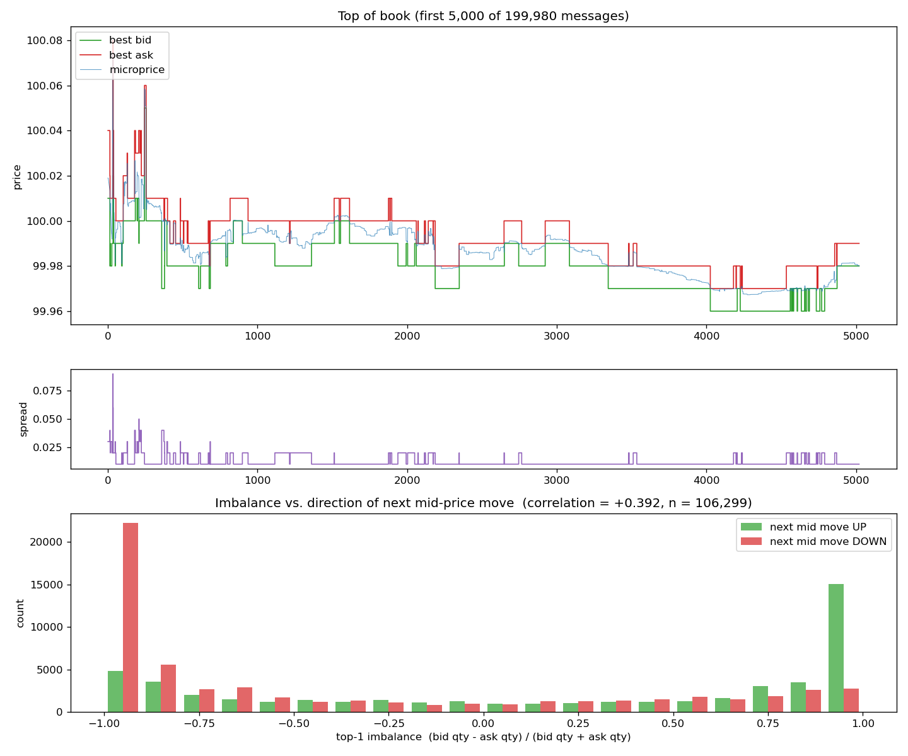

# Limit Order Book & Matching Engine (C++17)

A single-instrument **limit order book** that matches orders by **price-time priority**.
It supports limit orders (GTC / IOC / FOK), market orders, cancels and modifies.
There are two implementations:

- **v1** is built from standard containers and is easy to reason about.
- **v2** is a cache-friendly, allocation-light version with the same behaviour.

Both are checked message-by-message against a deliberately naive reference model
on millions of random messages. They're benchmarked for throughput and tail
latency, and the book also produces market-microstructure statistics
(spread, mid, microprice, order-book imbalance, VWAP). It can replay
NASDAQ order-by-order data in LOBSTER format.

## Results (Apple M4, clang 17, `-O3`, single thread)

Workload: 2,000,000 synthetic messages. The mix is 56% adds, 34% cancels, 6% modifies
and 4% market orders, with prices clustered near the touch and ~940k fills
(`make bench`, seed 42).

| | v1 `std::map` + `std::list` | v2 pool + flat map + vector levels | speed-up |
|---|---|---|---|
| **Throughput** | 13.0 M msg/s (76.9 ns/msg) | **29.7 M msg/s (33.7 ns/msg)** | **2.3×** |
| p50 latency | 42 ns | 41 ns | (at clock resolution) |
| p90 latency | 125 ns | 83 ns | 1.5× |
| **p99 latency** | 666 ns | **209 ns** | **3.2×** |
| p99.9 latency | 1208 ns | 458 ns | 2.6× |
| cancel p99 | 208 ns | 84 ns | 2.5× |

How to read these numbers:

- **The clock's resolution limits single-message timings.** macOS `steady_clock`
  ticks every 41.7 ns on Apple Silicon, so p50 values are quantised to that
  step. Throughput is total time ÷ messages, so it has no such limit.
- **Max latency spikes are rare one-off events,** such as the hash table doubling
  or the OS preempting the thread. In production you'd pre-size every container
  and pin the thread to a core.

Correctness:

| Check | Scale |
|---|---|
| Unit tests (both books) | 46 tests, 417 checks, under AddressSanitizer + UBSan |
| Differential fuzz vs reference model | 5,000,000 messages per book: identical trades, statuses, BBO and 64-level depth after **every** message |
| Bug detection (mutation checks) | A seeded stale-index bug is caught by the invariant checker and ASan (use-after-free); a seeded wrong-modify-priority bug is caught by the fuzzer at message 36 |
| Sample replay | v1 and v2 produce byte-identical trade tapes, equal to a hand-verified expected tape |
| LOBSTER reconstruction | 11/11 book snapshots identical on the bundled sample |

Microstructure (200k-message replay of **synthetic** order flow, `make plot`):
top-of-book imbalance has a **+0.39 correlation** with the direction of the
next mid-price move. Part of this is mechanical: a thin side is more likely to
be emptied. Treat it as a demonstration of the analysis pipeline. The
predictive result to quote comes from re-running this on real LOBSTER data.



## What it does

| Feature | Details |
|---|---|
| Limit orders | Match what crosses, then **GTC** rests the remainder, **IOC** discards it, **FOK** fills completely or is killed with no trades |
| Market orders | Sweep the opposite side; never rest |
| Cancel | O(1) lookup of the order via an id → location index |
| Modify | Reducing quantity at the same price keeps queue priority. A price change or a size increase is treated as cancel + re-add, so the order loses priority (and may trade) |
| Validation | Rejects qty ≤ 0, duplicate live ids, cancels/modifies of unknown ids |
| Queries | Best bid/ask, volume at a price, top-N depth (L2), per-order remaining qty |
| Statistics | Spread, mid, microprice, top-N imbalance, VWAP / high / low / last |
| Replay | CSV order files → trade tape + per-message top-of-book CSV |
| Real data | LOBSTER (NASDAQ ITCH reconstruction) message files, with snapshot-by-snapshot comparison |

**Matching rule.** The best price trades first. At the same price, the earliest order
trades first. Every trade executes at the **resting** order's price.

## Design

```
                 add / cancel / modify / market
                              │
               ┌──────────────┴──────────────┐
               │  id → location index        │  O(1): find any order by id
               └──────────────┬──────────────┘
      BIDS (best = highest)   │   ASKS (best = lowest)
  price level → FIFO queue    │   price level → FIFO queue
  501.00 → [#10:4]            │   502.00 → [#4:10]
  499.00 → [#3:4]             │   501.50 → [#7:2][#9:5]
```

| | v1 | v2 (optimised) |
|---|---|---|
| Price levels | `std::map<Price, Level>` (red-black tree), comparator flipped for bids | `std::vector<Level>` sorted worst → best; best level at `back()` |
| Orders in a level | `std::list<Order>` | Intrusive doubly linked list of `uint32` indices into one pooled `std::vector<Node>` + free list |
| Id index | `std::unordered_map<OrderId, Location>` | `FlatIdMap`: open addressing, linear probing, backward-shift deletion |
| Heap allocations per resting order | ~3 (list node, hash node, sometimes a map node) | **0** in steady state |

| Operation | v1 | v2 |
|---|---|---|
| Add (rests) | O(log M) | O(log M) search + O(1) insert near the top |
| Cancel | O(1) index + O(log M) level | same, without pointer chasing |
| Each fill | O(1) | O(1) |
| Best bid/ask | O(1) | O(1) |

M is the number of distinct price levels on one side.

**Why v2 is faster.** It does the same algorithm with fewer cache misses and no
`malloc`/`free` on the hot path:

- Level searches scan a contiguous array instead of chasing tree pointers.
- Most activity is at the top of the book, which is the end of the vector, so
  inserts and erases shift few elements.
- Order nodes are reused from a free list.
- The id index is one flat array.

Every decision, with rejected alternatives, is in [docs/04_DESIGN_DECISIONS.md](docs/04_DESIGN_DECISIONS.md).
Key type choices:

- **Prices are `int64_t` ticks, never `double`.** In floating point,
  `0.1 + 0.2 != 0.3`, so a `double` price would split one price level into two
  map keys. Prices are signed because they can be negative (WTI crude, April 2020).
- **Ids are `uint64_t`.**
- **Per-order quantity is `int32_t`,** matching NASDAQ ITCH. Aggregates are `int64_t`.

## Testing strategy

1. **Unit tests** ([tests/test_order_book.cpp](tests/test_order_book.cpp)) cover:
   - every worked example
   - FIFO order within a level, sweeps, cancels, IOC/FOK, all three modify paths
   - rejects and negative prices

   Each scenario runs on both books. After every operation, `check_invariants()`
   verifies:
   - the book is never crossed
   - there are no empty levels
   - level totals equal the sum of their orders
   - the index points at exactly the resting orders
2. **Reference model** ([tests/reference_book.hpp](tests/reference_book.hpp)) is a flat vector
   with linear scans and no clever bookkeeping, so it's correct by inspection.
3. **Differential fuzzer** ([tests/fuzz.cpp](tests/fuzz.cpp)) feeds the same random stream to a
   book and the reference, and stops at the first difference in any output. The
   stream deliberately includes:
   - duplicate ids, and cancels/modifies of dead ids
   - zero and negative quantities
   - FOK orders that can't fill
   - market orders into an empty book
   - a 30-tick price band, so orders constantly cross and queue
4. **Sanitizers.** All tests run under ASan + UBSan, so a dangling index entry
   is reported as a use-after-free instead of corrupting data silently.

## Build & run

Requires `clang++` (C++17) and `make`. No external libraries. Plotting needs
`python3` with `matplotlib`.

```bash
make            # build everything (optimised)
make test       # unit tests + fuzz + sample replays, under ASan/UBSan
make fuzz       # 1M messages x 5 seeds per book against the reference model
make bench      # v1 vs v2 throughput and latency -> results/bench.csv
make plot       # generate 200k orders, replay, plot -> results/bbo.png
make run        # step-by-step demo of the worked example
```

```bash
./build/replay data/sample_orders.csv --trades trades.csv --bbo bbo.csv   # --book v1|v2, --decimals N
./build/gen_orders 1000000 orders.csv [seed]
./build/lobster_replay data/lobster_sample_message.csv data/lobster_sample_orderbook.csv
```

**Real NASDAQ data.**

1. Download a free sample from [lobsterdata.com](https://lobsterdata.com/info/DataSamples.php)
   (e.g. AAPL, level 1 or 10). The download contains `*_message_N.csv` and `*_orderbook_N.csv`.
2. Run `./build/lobster_replay <message file> <orderbook file>`.

The file starts mid-session. Orders placed before that point are unknown to the
engine, so the book is seeded from the first snapshot and events on those older
orders are applied to the seeded levels. The tool reports how many snapshots
match exactly.

## Project layout

```
include/   types, OrderBook (v1), FastOrderBook (v2), FlatIdMap, stats, CSV, order-flow generator
src/       v1 + v2 implementations, CSV parsing, demo main
apps/      replay, gen_orders, lobster_replay
tests/     unit tests, reference model, differential fuzzer
bench/     latency / throughput benchmark
analysis/  plot_bbo.py
data/      sample order file + expected trades, LOBSTER-format sample
results/   benchmark CSV, plot
docs/      problem statement, design questions, roadmap, design decisions
```

## Resume bullet

> Built a price-time-priority **limit order book and matching engine in C++17**
> (limit/market/IOC/FOK, cancel, modify). An allocation-free v2 (pooled intrusive
> lists, open-addressing hash index, cache-friendly price levels) reached
> **29.7M msgs/s** with **p99 latency of 209 ns**, **2.3× throughput and 3.2× p99
> over a std::map/std::list baseline**. Verified with differential fuzzing against
> a reference model (5M messages, ASan/UBSan). Built replay and analytics tooling
> (spread, microprice, order-book imbalance, VWAP) and a LOBSTER/NASDAQ
> book-reconstruction checker.

Once you've run `lobster_replay` on a real LOBSTER sample, you can add
"reconstructed NASDAQ order books with X% snapshot accuracy" and the imbalance
correlation measured on that real data.

## Docs

| Doc | Contents |
|---|---|
| [01 Problem statement](docs/01_PROBLEM_STATEMENT.md) | What an LOB is, matching rules, worked example, feature tiers, invariants |
| [02 Design questions](docs/02_DESIGN_QUESTIONS.md) | The design questions the project answers |
| [03 Roadmap](docs/03_ROADMAP.md) | The 12 build phases and where each lives in the code |
| [04 Design decisions](docs/04_DESIGN_DECISIONS.md) | Every choice, why, what was rejected, complexity, v2 optimisations |
| [References](docs/REFERENCES.md) | Reading, data sources, example repos |
